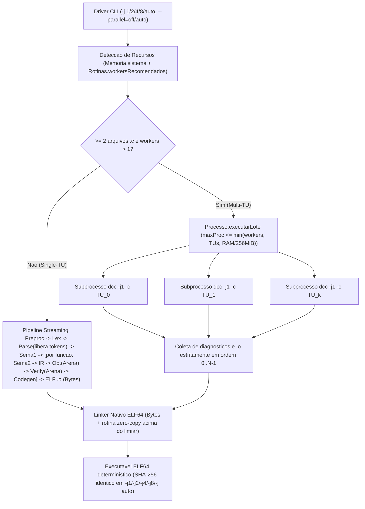

# Arquitetura de Paralelismo Adaptativo e Determinismo — DCC 0.2.0 (Ciclo V)

Data: 21/11/2026  
Ambiente: Linux x86-64 Fedora 44, Intel Core i5-11300H (4 núcleos físicos / 8 threads lógicas), 15 GiB RAM, CGD 0.9.0 (Ciclo IV).

---

## 1. Matriz de Paralelizabilidade por Fase do DCC (§6)

Antes de implementar qualquer paralelismo, todas as 23 unidades de código-fonte do DCC foram auditadas quanto a estado global (confirmado: **zero variáveis globais mutáveis** em todos os módulos) e dependências de dados reais:

| Fase | Estado Compartilhado | Paralelizável Intra-TU? | Paralelizável Multi-TU? | Decisão de Engenharia (Ciclo V) |
|---|---|---|---|---|
| **Pré-processador (`preproc.delegua`)** | Tabela de macros `#define`/`#undef`, pilha `#if`, cache de headers | **Não** (semântica C99 estritamente sequencial por linha) | **Sim** (100% independente por TU) | **Paralelo Multi-TU** via pool limitado de subprocessos (`Processo.executarLote`) |
| **Lexer (`lexer.delegua`)** | Estado léxico de comentários/strings/linha | **Não** (contexto léxico sequencial) | **Sim** | **Paralelo Multi-TU** |
| **Parser (`parser.delegua`)** | Pilha léxica de `typedef` (exigida pela gramática C99 para desambiguar `(T)*x`) | **Não** (C99 exige tabela de `typedef` em ordem) | **Sim** | **Paralelo Multi-TU** + liberação progressiva de `TokenC99` + `Memoria.coletarSeAcima` mid-parse |
| **Semântica Passe 1 (`sema.delegua`)** | Layouts `struct`/`union`, enums, globais, assinaturas | **Não** (declarações dependem de ordem) | **Sim** | **Sequencial rápido** (`~160 ms` em `frozen_dcc.c`) |
| **Semântica Passe 2 (`verificarCorpoFuncao`)** | Somente leitura sobre `tabela`/`funcoes`/`globais` | Teoricamente sim (por função), mas representa apenas ~5% do tempo (`~450 ms`) | **Sim** | **Streaming por função** (libera AST imediatamente após baixar IR) |
| **IR Builder (`ir_builder.delegua`)** | Mutação de `modulo.stringsBytes` (interning) e `static` locais | Requer barreira de numeração de strings/globais para determinismo | **Sim** | **Streaming por função** (mantém ordem exata de `.rodata`/`.data`/`.symtab`) |
| **IR Opt + Verify (`ir_opt`, `ir_verify`)** | 100% independente por `FuncaoSSA` | Sim (por função), mas após otimização $O(1)$ + `Arena` caiu para **`838 ms`** (~10% do total) | **Sim** | **Streaming + `cgd:memoria.Arena` + DCE por contagem de usos** |
| **Codegen x86-64 (`codegen`, `emissor`)** | Independente por função (exceto rel32 inter-função `fn_*`) | Sim (por função), mas representa **`928 ms`** (~11% do total) | **Sim** | **Streaming + resolução imediata de labels locais (`resolverPatchesFuncao`)** |
| **Emissor ELF64 `.o` (`elf_obj.delegua`)** | Escrita contígua de 11 seções | **Não compensa** (`56 ms` em `18,95 MiB`) | **Sim** | **Sequencial em `Bytes`** (`56 ms`) |
| **Linker Nativo ELF64 (`linker`, `elf_leitor`)** | Leitura/validação de `.o`/`.a` e cálculo de patches de relocação | **Sim** (por objeto/membro `.a` e lotes de relocações) | **Sim** | **Paralelo via `rotina` + `Bytes` congelado *zero-copy*** com limiares empíricos |

### Análise Honesta da Lei de Amdahl Intra-TU (Por que não forçar `rotina` no backend single-TU)
Na compilação single-TU de `frozen_dcc.c` (`8,29 s` internos em `clang -O2` após as otimizações sequenciais do Ciclo V):
- Frontend + IR sequenciais inevitáveis (`preprocess + lex + parse + sema + ir + elf_obj`): **`6.519 ms` (`78,6%`)**.
- Backend independente (`opt+verify + codegen`): **`1.766 ms` (`21,4%`)**.
- **Limite teórico da Lei de Amdahl** (mesmo com infinitos núcleos e 0 overhead): `1 / 0,786 = 1,27×`.
- Além disso, o runtime de rotinas do CGD exige auditoria estática rigorosa (`E3402`) que proíbe chamadas dinâmicas sobre `qualquer` (necessário atualmente em passes cross-módulo em Delégua por ausência de tipos qualificados por módulo), e a serialização + desserialização de ~804 mil `InstSSA` (~19 MiB) somada à contenção do Boehm GC (`1,94×` em 4 threads alocando) reduziria o ganho real intra-TU para < 5–10% com maior consumo de RAM.
- **Decisão**: concentrar paralelismo real onde há ganho expressivo e isolamento limpo: **Multi-TU via `Processo.executarLote`** (escalabilidade `1,85×–2,36×` sem contenção de GC) e **Linker ELF64 via `rotina` + `Bytes` congelado** (100% estaticamente auditado pelo `E3402`), mantendo o single-TU no pipeline streaming otimizado (`-28,5%` tempo, `-42,4%` RSS).

---

## 2. DAG de Compilação e Linkagem (Ciclo V)

---

## 3. Política Conservadora de Recursos e Interface CLI

Opções implementadas em `src/driver/cli.delegua`:
- `-j <N|auto>` e `-j<N>` / `-jauto` (`N` inteiro estrito `>= 1`, teto de segurança `32`; rejeita `0`, negativos e strings inválidas com erro explícito e exit 1).
- `--parallel=off` (equivale a `-j 1`) e `--parallel=auto` (equivale a `-j auto`).
- Variável de ambiente `DCC_JOBS` (fallback quando não especificado na CLI).
- **Modo padrão (`auto`)**:
  - Consulta `cgd:assincrono.Rotinas.workersRecomendados(134217728)` (`128 MiB`/worker), baseado em `sched_getaffinity` + quotas cgroup v2/v1 + `/proc/meminfo` + pressão de memória.
  - Em 2 CPUs (validado via `taskset -c 0,1 dcc -j auto -v`): detecta `cpusEff=2` e escolhe **`workers=1`** (conservador).
  - Nesta máquina (4 núcleos físicos / 8 threads lógicas, 15 GiB RAM): escolhe **`workers=4`** (reserva metade das threads lógicas para o sistema).
  - Em Multi-TU, limita adicionalmente processos concorrentes a `RAM_disponivel_MiB / 256` (no modo `auto`), evitando saturação de memória.

---

## 4. Garantia de Determinismo Bit a Bit

1. **Multi-TU**: subprocessos gravam `.o` isolados; diagnósticos em `stderr` são emitidos rigorosamente na ordem dos argumentos da CLI; arquivos temporários são sempre removidos (inclusive em falha); o linker recebe objetos na ordem exata da CLI.
2. **Single-TU streaming**: `simbolosFuncoes` é acumulado separadamente e anexado ao `obj.simbolos` após todas as globais (incluindo `static` locais de funções), preservando 100% a ordem de `.rodata`, `.data`, `.bss`, `.text`, `.rela.text`, `.rela.data`, `.symtab` e `.strtab`.
3. **Linker paralelo**: leitura paralela de `.o`/`.a` e preparação paralela de patches de relocação preservam os índices originais `0..N-1`; a resolução de símbolos globais/fracos/COMMON, extração de ponto fixo de `.a` e aplicação final de patches ocorrem em ordem determinística estrita.
4. **Prova experimental**: SHA-256 **100% idêntico** validado em:
   - `frozen_dcc.c` (`18.951.128 B`): `9b3c0d377d05a831e309977ef4287f595bad4ee07bf238dc4f345da8d44a1d39` idêntico entre **Cycle IV**, **Cycle V Clang -O2**, **GCC -O0**, **Clang -O0**, **TinyCC -O0**, **`-j1`**, **`-j2`**, **`-j4`**, **`-j8`** e **`-j auto`**.
   - Multi-TU (17 `.c` → executável): `b3cbb0ec9156a95603e8526852013d9f7e92fa6d541868b81da35a4e2088a694` idêntico em `-j1/-j2/-j4/-j8/-j auto/taskset`.
   - Linker (1, 10, 100, 300 `.o` e suite 22 `.o` + `.a` + >2.600 relocs sob `DCC_FORCE_PAR_LINKER=1`): SHA-256 idêntico em `-j1/-j2/-j4/-j8/-j auto`.
